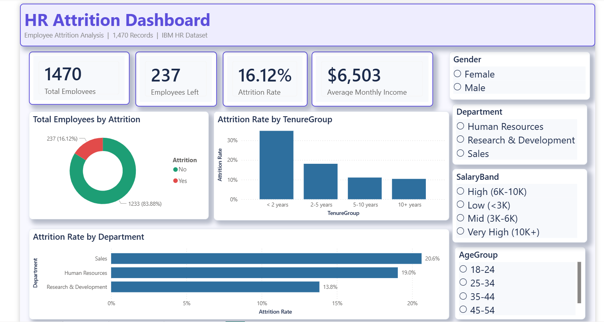
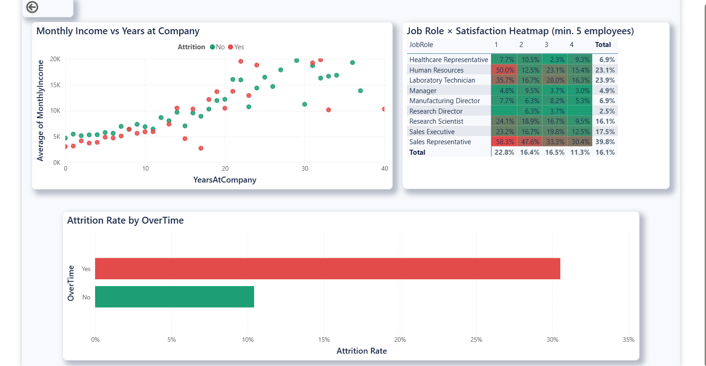
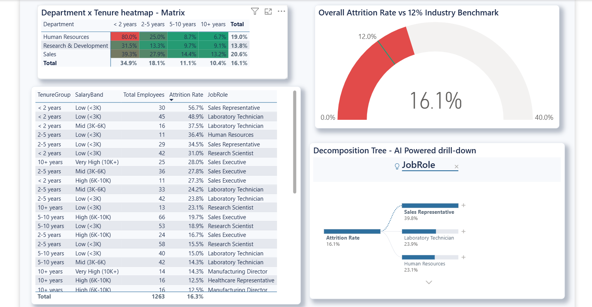

# HR Analytics Dashboard — Employee Attrition Insights

### Turning Employee Data into Actionable Workforce Retention Strategies

An end-to-end HR Analytics solution built using **Python, PostgreSQL, Statistical Analysis, and Power BI** to investigate employee attrition across **1,470 employee records and 35 workforce attributes**.

The analysis identifies employee segments associated with higher attrition, including early-career employees (32.6%), overtime workers (30.5%), and Sales Representatives (39.8%). These findings are translated into actionable workforce retention recommendations to support data-driven HR decision-making.

<p align="left">
  
  
  
  
  
  
</p>

**Quick Navigation:**  
[Business Problem](#2-business-problem) | [Dataset](#3-dataset-overview--data-dictionary) | [Methodology](#5-methodology--analytical-workflow) | [Dashboard](#6-dashboard-preview--visual-highlights) | [Key Findings](#7-key-insights--findings) | [Recommendations](#8-actionable-business-recommendations)

**Dashboard:** [Power BI Dashboard (.pbix)](dashboard/HR_Attrition_Dashboard.pbix) | [Dashboard Guide](dashboard/POWERBI_GUIDE.md)

**Dataset:** [IBM HR Analytics — Kaggle](https://www.kaggle.com/datasets/pavansubhasht/ibm-hr-analytics-attrition-dataset)

---

## 2. Business Problem

Employee attrition creates significant operational challenges for organizations, including recruitment expenses, onboarding costs, productivity losses, and disruptions to workforce planning.

However, understanding the overall attrition rate alone is not enough. HR teams need to identify which employee segments experience higher turnover and understand the workplace factors associated with employees leaving the organization.

This project simulates the role of a Data Analyst working with an HR team to investigate employee attrition and support evidence-based retention strategies.

### Key Business Challenges

- Identify departments and job roles experiencing higher employee attrition.
- Understand how compensation, overtime, job satisfaction, and tenure relate to employee turnover.
- Identify early-career employee segments requiring additional retention attention.
- Translate workforce analytics into practical HR recommendations.

**Business Objective:** Help HR stakeholders move from reactive employee turnover reporting toward targeted, data-informed workforce retention planning.

---

## 3. Dataset Overview & Data Dictionary

### Dataset Summary

| Attribute | Details |
|---|---|
| Dataset | IBM HR Analytics Employee Attrition & Performance |
| Source | Kaggle |
| Records | **1,470 employees** |
| Features | **35 columns** |
| Format | CSV |
| Data Type | Synthetic HR workforce dataset |
| Primary Analysis | Attrition, Compensation, Tenure, Satisfaction, Job Roles |
| Target Variable | Attrition (Yes / No) |

**Dataset Source:** [IBM HR Analytics Employee Attrition & Performance — Kaggle](https://www.kaggle.com/datasets/pavansubhasht/ibm-hr-analytics-attrition-dataset)

> Note: The dataset is synthetic and intended for educational and analytical purposes.

### Key Data Dictionary

| Column / Feature | Data Type | Business Definition |
|---|---|---|
| Age | Integer | Employee age |
| Attrition | Categorical | Indicates whether an employee left the organization |
| BusinessTravel | Categorical | Employee business travel frequency |
| Department | Categorical | Employee department |
| DistanceFromHome | Integer | Distance between home and workplace |
| Education | Integer | Employee education level |
| JobRole | Categorical | Employee job designation |
| JobSatisfaction | Integer | Employee job satisfaction rating |
| MonthlyIncome | Integer | Employee monthly salary |
| OverTime | Categorical | Indicates whether an employee works overtime |
| YearsAtCompany | Integer | Employee tenure in the organization |
| YearsInCurrentRole | Integer | Years spent in the current job role |
| WorkLifeBalance | Integer | Employee work-life balance rating |
| EnvironmentSatisfaction | Integer | Workplace environment satisfaction rating |

*The table highlights selected analytical fields from the 35-column dataset.*

---

## 4. Project Objectives & Key Business Questions

### Project Objectives

1. Analyze overall employee attrition and workforce distribution across departments and job roles.
2. Identify employee segments with higher attrition rates using tenure, compensation, overtime, and satisfaction metrics.
3. Apply statistical hypothesis testing to examine relationships between employee characteristics and attrition.
4. Develop an interactive Power BI dashboard to communicate workforce insights and support HR decision-making.

### Key Business Questions

1. Which departments and job roles experience the highest employee attrition rates?
2. Are employees with shorter organizational tenure more likely to leave?
3. How does monthly income or salary band relate to employee attrition?
4. Does working overtime correspond with higher employee turnover?
5. How do job satisfaction scores differ between employees who leave and those who stay?
6. Which employee segments should HR prioritize for retention initiatives?
7. How can HR use workforce analytics to develop targeted retention strategies?

---

## 5. Methodology & Analytical Workflow

The project follows an end-to-end analytics workflow, combining database management, Python-based data processing, statistical analysis, and business intelligence reporting.

### Step 1: Data Cleaning & Preparation — Python

- Loaded the original IBM HR dataset containing 1,470 employee records.
- Performed data type validation and preprocessing.
- Prepared analytical features and employee segments.
- Created computed features for further attrition analysis.
- Exported the cleaned dataset for database loading and visualization.

**Tools:** Python 3.11, Pandas, Jupyter Notebook.

### Step 2: Database Design & SQL Analysis — PostgreSQL

- Designed a PostgreSQL database schema for HR analytics.
- Created database tables with computed columns.
- Loaded the processed employee dataset.
- Performed post-load data validation.
- Developed **10 business-focused SQL analytical queries**.
- Created a Power BI-oriented analytical view.

**Tools:** PostgreSQL 15, SQL.

### Step 3: Exploratory Data Analysis (EDA) — Python

- Analyzed employee attrition across departments and job roles.
- Examined compensation, tenure, overtime, and satisfaction patterns.
- Created **8 visualizations** to understand workforce distributions and attrition trends.
- Used KDE plots, box plots, and heatmaps to explore employee characteristics.

**Tools:** Pandas, Matplotlib, Seaborn.

### Step 4: Statistical Analysis & Hypothesis Testing

Applied statistical methods to investigate relationships between employee characteristics and attrition.

| Statistical Method | Analytical Purpose |
|---|---|
| Chi-Square Test | Examined associations between categorical variables and attrition. |
| Point-Biserial Correlation | Evaluated relationships between continuous variables and the binary attrition outcome. |
| Mann-Whitney U Test | Compared income distributions between employees who left and employees who stayed. |
| Distribution Analysis | Used KDE plots and box plots to examine employee income and satisfaction distributions. |
| Cohort Analysis | Segmented employees by tenure to identify higher-risk workforce groups. |

**Tools:** SciPy, Statsmodels, Python.

### Step 5: Power BI Dashboard Development

Developed a **three-page interactive HR Analytics dashboard**.

- **Overview Page:** High-level workforce and attrition performance.
- **Drill-Through Analysis:** Detailed employee segment and job-role investigation.
- **Risk Dashboard:** Focused analysis of employee characteristics associated with higher attrition.

**Tools:** Power BI Desktop.

### Step 6: Business Reporting & Recommendations

- Consolidated analytical findings into an executive summary.
- Identified priority employee segments for retention planning.
- Translated statistical and descriptive findings into practical HR recommendations.
- Prepared an executive business report in PDF format.

---

## 6. Dashboard Preview & Visual Highlights

The Power BI dashboard provides three analytical views to help HR stakeholders explore employee attrition and workforce risk patterns.

### 6.1 Executive Overview



*Provides a consolidated overview of employee attrition and workforce performance.*

### 6.2 Drill-Through Analysis



*Enables detailed investigation of employee segments and attrition patterns.*

### 6.3 Employee Risk Dashboard



*Highlights workforce segments associated with higher attrition and supports targeted retention analysis.*

### Explore the Dashboard

- [Download Power BI Dashboard](dashboard/HR_Attrition_Dashboard.pbix)
- [Read Power BI Dashboard Guide](dashboard/POWERBI_GUIDE.md)
- [View Executive Business Report](reports/HR_Attrition_Business_Report.pdf)

---

## 7. Key Insights & Findings

The analysis identified several important workforce patterns across the 1,470 employee records.

### 7.1 Early-Career Employees Show Higher Attrition

| Employee Tenure | Attrition Rate |
|---|---:|
| Less than 2 years | **32.6%** |
| 10+ years | **10.2%** |

**Business Insight:** Employees with less than two years of organizational tenure have nearly **3 times the attrition rate** of employees with 10+ years of tenure.

### 7.2 Compensation Is Associated with Attrition

| Salary Segment | Attrition Rate |
|---|---:|
| Lowest Salary Band | **26.5%** |
| Highest Salary Band | **6.8%** |

**Business Insight:** The lowest salary band experiences substantially higher attrition than the highest salary band, highlighting compensation as an important area for HR investigation.

### 7.3 Overtime Workers Have Higher Attrition

| Employee Group | Attrition Rate |
|---|---:|
| Overtime Employees | **30.5%** |
| Non-Overtime Employees | **10.4%** |

**Business Insight:** Employees working overtime have almost **3 times the attrition rate** of employees who do not work overtime.

### 7.4 Sales Department Has the Highest Attrition

| Department / Job Role | Attrition Rate |
|---|---:|
| Sales Department | **20.6%** |
| Sales Representatives | **39.8%** |

**Business Insight:** Sales Representatives represent a particularly important employee segment for targeted retention investigation.

### 7.5 Job Satisfaction Is Associated with Attrition

| Job Satisfaction Score | Attrition Rate |
|---|---:|
| Score 1 — Low | **22.8%** |
| Score 4 — Very High | **11.3%** |

**Business Insight:** Employees reporting low job satisfaction experience higher attrition than employees reporting very high satisfaction.

### Statistical Validation

The project applied formal statistical methods to investigate the observed relationships:

- Chi-Square Tests
- Mann-Whitney U Tests
- Point-Biserial Correlation

The reported findings were examined through these statistical analyses. The observed associations should not be interpreted as proof of causation.

---

## 8. Actionable Business Recommendations

Based on the findings, five practical recommendations were developed for HR stakeholders.

| Business Finding | Recommended Action | Expected Business Benefit |
|---|---|---|
| 32.6% attrition among employees with less than 2 years of tenure | Introduce structured 90-day and 12-month onboarding check-ins. | Improve early employee engagement and identify retention concerns sooner. |
| 26.5% attrition in the lowest salary band | Conduct compensation benchmarking for lower salary bands, prioritizing Sales and R&D roles. | Identify potential compensation-related retention gaps. |
| 30.5% attrition among overtime employees | Establish department-level overtime thresholds and review workload capacity. | Support workload management and employee well-being. |
| 22.8% attrition among employees with low job satisfaction | Introduce quarterly employee pulse surveys and manager follow-ups for low satisfaction scores. | Identify employee concerns and support targeted engagement initiatives. |
| Higher attrition across specific workforce segments | Integrate a composite employee risk score into HR reporting. | Help HR prioritize employee segments requiring further investigation. |

### Estimated Business Impact

The project's executive report estimates that a **30% improvement in the high-risk employee segment** could retain approximately **13 employees per year**, potentially avoiding an estimated **$585,000–$780,000 in employee replacement costs**.

> This is a scenario-based estimate from the project report, not a measured or realized saving. It depends on the assumed replacement costs and retention improvement being achievable and should be validated against actual organizational salary and hiring data.

---

## 9. Repository Structure & How to Run

### Project Architecture

```text
hr-attrition-analytics/
│
├── data/
│   ├── raw/
│   │   └── HR_Employee_Attrition.csv
│   └── processed/
│       └── hr_cleaned.csv
│
├── sql/
│   ├── 01_create_schema.sql
│   ├── 02_load_data.sql
│   └── 03_analytical_queries.sql
│
├── notebooks/
│   ├── 01_data_cleaning.ipynb
│   ├── 02_eda_analysis.ipynb
│   └── 03_statistical_analysis.ipynb
│
├── dashboard/
│   ├── HR_Attrition_Dashboard.pbix
│   ├── POWERBI_GUIDE.md
│   └── dashboard_screenshots/
│       ├── Overview.png
│       ├── DrillThrough.png
│       └── risk_dashboard.png
│
├── reports/
│   ├── executive_summary.md
│   └── HR_Attrition_Business_Report.pdf
│
├── hr_theme.json
├── requirements.txt
├── .gitignore
└── README.md
